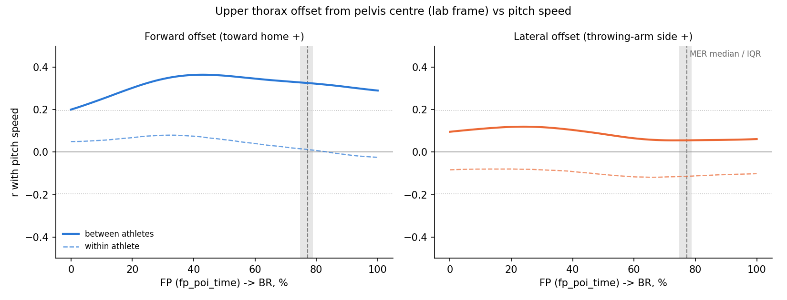

# 軀幹在骨盆上方的位置與球速

## 結論

這裡看的是上胸在實驗室座標中，相對骨盆中心的水平位置，不是軀幹角度。

- **前後方向：初步支持（投手間）。** 落地後上胸越早、越多跑到骨盆前方（往本壘方向）的投手，球速越快。整段 FP→BR 都有關聯，最強在約 43% 處（r = 0.37），MER 與 BR 時 r 約 0.3。校正體型後約每多 10 cm 快 1.7 mph。這個訊號比軀幹前傾角強；把偏移量放進模型後，前傾角不再提供任何球速資訊。
- **左右方向：不支持。** 上胸偏向手套側或投球手側的程度與球速無關（r ≤ 0.10）。
- **同一位投手每球之間：不支持。** 兩個方向都接近零（|r| ≤ 0.10），屬於投手之間的差異，不代表同一個人多往前帶就會變快。

## 位置怎麼變

| | FP | MER | BR |
|---|---:|---:|---:|
| 往前（本壘方向 +） | −5 cm | +21 cm | +28 cm |
| 往投球手側 + | −2 cm | −17 cm | −21 cm |

投手間 SD 各約 6–7 cm。FP 時上胸大致在骨盆正上方（略偏後），之後一路往前、往手套側移。

## 證據

投手間以各投手平均計算，100 位投手、411 球；括號為投手 bootstrap 95% CI。

| 前後偏移 | 與球速 r | 校正體重、身高 | 再校正軀幹前傾角 | 前傾角本身 r | 前傾角校正偏移後 |
|---|---:|---:|---:|---:|---:|
| FP | 0.20 (0.00–0.38) | 0.25 | 0.25 (0.04–0.43) | 0.04 | 0.04 |
| MER | 0.30 (0.08–0.50) | 0.27 | 0.16 (−0.05–0.36) | 0.18 | 0.00 |
| BR | 0.29 (0.08–0.48) | 0.24 | 0.17 (−0.04–0.37) | 0.12 | 0.00 |

- 時間序列：前後偏移形成 0–100% 的 cluster，平均 r = 0.32，cluster p < 0.001（打散投手球速 2000 次）；左右偏移沒有 cluster。
- 位移和角度部分重疊，重疊多少取決於軀幹轉到哪裡：MER 時前後偏移與前傾角 r = 0.79、左右偏移與側傾角 r = −0.89；FP 時軀幹還關著，前後偏移反而與側傾角 r = 0.84。所以「實驗室座標的位移」不是全新的資訊，而是把前傾和側傾依旋轉角度混在一起。
- MER、BR 時，偏移校正前傾角後的 CI 包含 0，獨立於前傾角的部分只算弱。

## 待驗證假說

- 上胸往前多，可能來自骨盆本身前傾、前髖屈曲，或軀幹在骨盆上的前傾；三者尚未拆開。可與 [[軀幹前傾分析]] 中的骨盆前傾與後股骨時序一起檢驗。
- 尚未檢驗「把軀幹往前帶」能否在同一位投手身上提升球速。

## 方法與重現

- 上胸 = `thorax_prox`（離兩肩中點約 5 cm）；骨盆中心 = `rear_hip` 與 `lead_hip` 中點；資料 `landmarks.csv`（左投未鏡像）。
- 前後 = lab x；左右 = lab y，換成投球手側為正（右投 −y、左投 +y；以 BR 時投球肩與手套肩的 y 逐球檢查，411 球皆符合）。
- 事件：FP = `fp_poi_time`、MER = `MER_time`、BR = `BR_time`；時間序列範圍 start = `fp_poi_time`、end = `BR_time`，正規化為 0–100%，圖中標 MER 中位數與 IQR。
- 腳本：`baseball_pitching/code/py/analyze_trunk_over_pelvis_speed.py`；輸出 `trunk_over_pelvis_speed_outputs/`；分析日期 2026-11-26。
